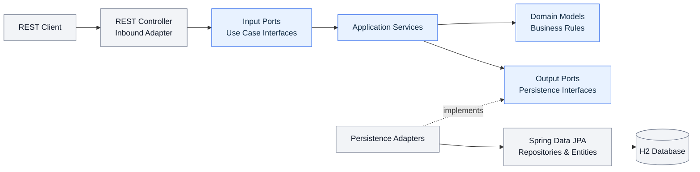
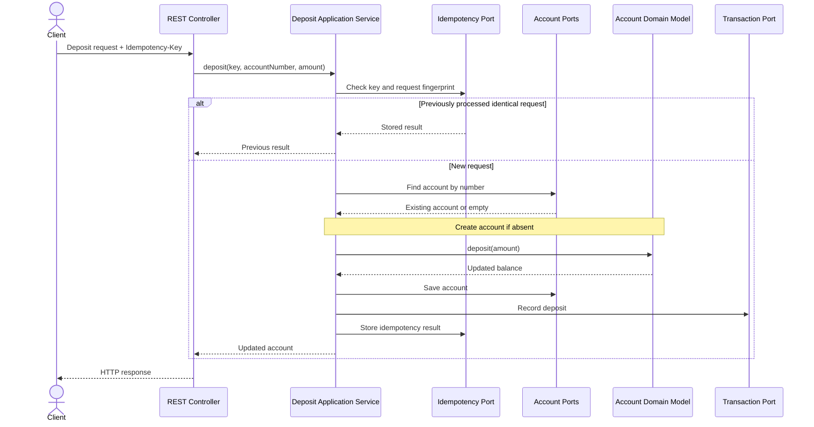

# Banking Backend — Hexagonal Architecture

A Java and Spring Boot REST API for essential banking operations, built using **Hexagonal Architecture (Ports & Adapters)**.

This project is the architectural evolution of my [Layered Architecture implementation](https://github.com/erduan-ramadani/banking-backend-layered). Both versions implement the same banking domain, making it easier to compare a conventional layered design with an approach that separates business rules from frameworks and infrastructure.

## Architecture at a glance



**Key idea:** Business logic lives in the domain and application layers. REST and database implementations are adapters, connected through interfaces (ports). The application does not need to know how data is stored.

## Features

- **Deposit** money into an account; create the account if it does not exist.
- **Withdraw** money with positive-amount and sufficient-funds validation.
- **Transfer** money between accounts with transactional consistency.
- **Balance lookup** by account number.
- **Transaction history** for account activity.
- **Idempotency keys** for write operations to prevent duplicate processing; conflicting reuse of a key is rejected.
- **Optimistic locking** using JPA `@Version` to detect concurrent account updates.
- **Centralized exception handling** with appropriate HTTP error responses.

## Technology stack

| Area | Technology |
| --- | --- |
| Language | Java |
| Framework | Spring Boot |
| API | REST / JSON |
| Persistence | Spring Data JPA / Hibernate |
| Database | H2 |
| Build | Maven |
| Tests | JUnit 5, Mockito |
| Architecture | Hexagonal Architecture, Ports & Adapters |

## Project structure

The important packages are organized by responsibility:

```text
com.eddiapps.banking
├── domain
│   ├── model                 # Account, Transaction, IdempotencyRecord
│   └── exception             # Business-rule exceptions
├── application
│   ├── port
│   │   ├── in                # Deposit, Withdraw, Transfer, Balance, History
│   │   └── out               # Account, transaction, idempotency ports
│   ├── service               # Use case implementations
│   └── exception
├── adapter
│   ├── in
│   │   └── web               # REST controllers, DTOs, exception handling
│   └── out
│       └── persistence       # JPA-backed port implementations
├── entity                    # JPA entities
└── repository                # Spring Data repositories
```

## Example: Deposit flow



## Business rules

| Operation | Important constraints |
| --- | --- |
| Deposit | Amount must be greater than zero |
| Withdraw | Amount must be greater than zero; sufficient balance required |
| Transfer | Different sender and recipient; both accounts must exist; sufficient funds; atomic update |
| Idempotent write | Same key and request returns the existing result; same key with a different request is rejected |
| Concurrent update | Stale account versions are rejected rather than silently overwriting changes |

### Error handling

The API maps domain and application errors to HTTP responses, including:

| Status | Example |
| --- | --- |
| `400 Bad Request` | Invalid amount or invalid transfer input |
| `404 Not Found` | Requested account does not exist |
| `409 Conflict` | Idempotency-key conflict or optimistic-locking conflict |
| `422 Unprocessable Entity` | Insufficient funds |

## Running locally

**Prerequisites:** A compatible JDK and Maven installation.

1. Clone the repository:

   ```bash
   git clone https://github.com/erduan-ramadani/banking-backend-hexagonal.git
   cd banking-backend-hexagonal
   ```

2. Start the Spring Boot application using your project's Maven wrapper, if present:

   ```bash
   ./mvnw spring-boot:run
   ```

   On Windows, use `mvnw.cmd spring-boot:run`. If the repository does not include a wrapper, use `mvn spring-boot:run`.

3. The application is configured to run locally at `http://localhost:8080` in the development setup.

### Run tests

```bash
./mvnw test
```

Or run individual test classes directly from IntelliJ IDEA.

> **Note:** The sample commands assume the Maven setup used in the project. Check the repository's build files and configuration for the exact JDK version and any environment-specific settings.

## Why Hexagonal Architecture?

The original implementation used a traditional flow of **Controller → Service → Repository**. The hexagonal version introduces explicit boundaries:

- **Domain:** Banking rules and entities, independent of HTTP and persistence.
- **Input ports:** Interfaces that describe what the application can do.
- **Application services:** Orchestrate use cases and transactions.
- **Output ports:** Interfaces for capabilities the application needs, such as saving accounts or transactions.
- **Adapters:** Translate between the application and external technologies such as REST and JPA.

This structure improves separation of concerns and makes core behavior easier to test with mocked ports. It also creates flexibility to replace infrastructure implementations without rewriting the business rules.

## Compare both implementations

| | Layered | Hexagonal |
| --- | --- | --- |
| Main organization | Technical layers | Domain, use cases, ports, adapters |
| Typical flow | Controller → Service → Repository | Inbound adapter → input port → application service → output port → outbound adapter |
| Persistence boundary | Service commonly depends on repository | Application depends on a persistence port |
| Main learning focus | Straightforward Spring Boot application structure | Dependency inversion and explicit architectural boundaries |

**Repositories:** [Layered version](https://github.com/erduan-ramadani/banking-backend-layered) · [Hexagonal version](https://github.com/erduan-ramadani/banking-backend-hexagonal)

## Author

**Erduan Ramadani** — Software Developer | Java, Spring Boot, Kotlin & Android

[GitHub profile](https://github.com/erduan-ramadani)
